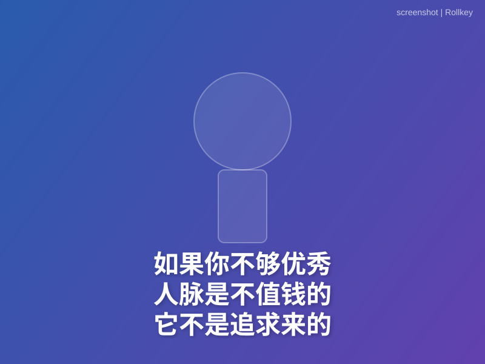

# 字幕截图生成器

一个现代化的字幕截图生成工具，让你轻松为名人演讲和访谈添加自定义字幕，生成具有说服力的截图。



> "都有截图了一定是真的" 😄

## ✨ 特性

- 🎨 **现代化UI** - 采用渐变背景和玻璃态设计
- 📱 **响应式设计** - 完美适配桌面和移动设备
- 🖼️ **多种背景** - 内置名人背景图 + 自定义图片上传
- 🔤 **多语言支持** - 中文、英文、中英双语字幕
- 🎛️ **实时调节** - 字体大小、行高、对齐方式实时预览
- 💧 **水印系统** - 可选择移除水印（需关注公众号）
- ⚡ **即时导出** - 一键导出高清PNG图片
- 🎯 **预设样式** - 多种预设样式快速应用

## 🚀 快速开始

### 安装依赖

```bash
npm install
# 或
yarn install
# 或
pnpm install
```

### 启动开发服务器

```bash
npm run dev
# 或
yarn dev
# 或
pnpm dev
```

在浏览器中访问 `http://localhost:3000`

### 在线画图

入口：`/zh/tools/online-drawing`（另有 `/en/` 和 `/ja/` 版本）。首页和导航菜单均已接入。

页面直接使用本站 Canvas 编辑器，图片编辑在浏览器本地完成。刷新或离开前请保存工程。

- 画笔、橡皮、油漆桶、吸管、文字、矩形、椭圆和直线。
- 图层移动、缩放、旋转、翻转、复制、排序、隐藏、锁定、不透明度和混合模式。
- 裁剪、画布尺寸调整、亮度、对比度、饱和度、模糊、撤销与重做。
- 打开 PNG / JPG / WebP / GIF / BMP，拖入多张图片添加图层，导出 PNG / JPG / WebP。
- `.imghub.json` 工程保留图层、文字和设置。暂不支持 PSD；关闭页面前需手动保存工程。

画布最大 4096 × 4096，最多 40 个图层，总源像素限制为 3200 万；撤销历史最多 30 步并限制内存占用。图片最大 25 MB，工程最大 60 MB。

核心测试：`node --test tests/drawing.test.mjs`。浏览器测试：先运行 `npm run dev -- --port 3001`，再运行 `node tests/drawing.e2e.mjs`。可以通过 `DRAWING_TEST_URL` 和 `DRAWING_TEST_CHROME` 指定服务地址和 Chrome 路径。截图与测试报告输出到忽略的 `test-results/drawing/` 目录。

交互回归：`node tests/drawing-regressions.e2e.mjs`，验证图层边界绘画、文字撤销、负坐标输入和保存提醒。

### 图片压缩

入口：`/zh/tools/image-compress/`，另有英文和日文版本。支持 JPG、PNG、WebP，图片在浏览器本地处理。

- 按画质压缩：默认 80%，智能比较原格式、WebP 和不含透明像素时的 JPG，选择更小的结果；若重编码更大则保留原图。每次重新压缩都读取原文件，避免重复有损编码。
- 限制文件大小：搜索满足目标的较高编码质量，可选择允许按比例缩小尺寸；无法达到目标时明确提示。可设置最大边长，图片不会被放大。
- PNG 原尺寸压缩直接重新压缩 IDAT 数据，保留精确像素、半透明颜色、调色板、色彩信息和 16 位样本；缺少浏览器流压缩支持时保留原文件。缩放或格式转换使用 Canvas。JPG 透明区域填白，智能模式保留透明。
- 显示实际编码文件字节数、尺寸及节省比例，支持前后对比、取消、删除和 ZIP 批量下载；同名图片不会覆盖。

最多 50 张，单张最大 50 MB，总输入不超过 200 MB。源图边长限制 16384、总像素限制 80 Mi；Canvas 输出边长限制 8192、总像素限制 32 Mi。超大图片需设置较小边长。暂不处理动画图片。

核心测试：`node --test tests/compression.test.mjs`。浏览器测试：启动 3001 端口的开发服务后运行 `node tests/compression.e2e.mjs`；可通过 `COMPRESSION_TEST_URL` 和 `COMPRESSION_TEST_CHROME` 指定服务地址和 Chrome 路径。浏览器测试验证实际文件、透明像素、画质差异、目标体积、ZIP、取消及多语言布局，报告和截图位于忽略的 `test-results/compression/`。

### 视频封面下载

入口：`/zh/tools/video-thumbnail/`，另有英文和日文版本。哔哩哔哩完整视频链接、BV / AV 号及分享文字中的完整链接会自动识别；YouTube 支持 watch、youtu.be、embed、Shorts 和 live 链接。B 站结果显示标题、UP 主及原始封面尺寸；YouTube 显示多个清晰度。下载在浏览器 Canvas 中转为 WebP，保留封面原始尺寸。

网站保持 Astro 静态输出，可直接部署 Vercel，无 API 路由、Node 服务、Serverless Function、第三方代理或 API Key。B 站使用固定官方接口 `https://api.bilibili.com/x/web-interface/view` 的 JSONP 回调，图片从平台 CDN 读取。公开视频被删除、接口限流或超时会显示错误并允许重试。平台接口或 CDN 策略可能影响可用性。

浏览器无法跨域读取 b23 短链接重定向，因此该输入会提示打开短链接并复制跳转后的完整视频地址，不自动代解析。B 站和 YouTube 的原图链接可在结果中复制。浏览器不支持 WebP 编码或图片下载失败时会明确提示，不输出伪 WebP 文件。

验证：`node --test tests/video-thumbnail.test.mjs`。

### 静态构建

```bash
npm run build
# 或
yarn build
# 或
pnpm build
```

## 📁 项目结构

```
imghub/
│── public/
│   ├── assets/heroes/     # 名人背景图
│   └── favicon.svg        # 网站图标
│
│── src/
│   ├── components/
│   │   ├── ScreenshotGenerator.jsx  # 主组件
│   │   ├── HeroSelector.jsx         # 英雄选择器
│   │   ├── SubtitleInput.jsx        # 字幕输入
│   │   ├── CanvasPreview.jsx        # 预览区
│   │   ├── Controls.jsx             # 样式控制
│   │   └── WatermarkModal.jsx       # 水印弹窗
│   │
│   ├── layouts/
│   │   └── Layout.astro             # 页面布局
│   │
│   ├── pages/
│   │   └── index.astro              # 主页
│   │
│   ├── styles/
│   │   └── global.css               # 全局样式
│   │
│   └── utils/
│       └── scrollStitch.js          # 长截图滚动拼接
│
└── package.json
```

## 🎨 技术栈

- **框架**: [Astro](https://astro.build/) - 静态站点生成
- **UI框架**: [React](https://reactjs.org/) - 交互组件
- **样式**: [Tailwind CSS](https://tailwindcss.com/) - 原子化CSS
- **图标**: [Lucide React](https://lucide.dev/) - 现代图标库
- **图片生成**: HTML5 Canvas API

## 📖 使用说明

### 1. 选择背景

- **系统背景**: 从下拉列表中选择内置的名人背景图
- **自定义背景**: 上传本地图片作为背景

### 2. 输入字幕

- 支持多行文本输入
- 选择字幕类型：中文 / 英文 / 中英双语
- 使用快速模板或自定义内容

### 3. 调整样式

- **字体大小**: 20-80px 滑块调节
- **行高**: 1.0-2.5 倍行距
- **对齐方式**: 左对齐 / 居中 / 右对齐
- **垂直位置**: 顶部 / 中间 / 底部
- **预设样式**: 一键应用预定义样式

### 4. 导出图片

- 实时预览效果
- 一键导出高清PNG格式
- 默认带水印，可选择移除

## 🖼️ 添加背景图片

将名人背景图片放置在 `public/assets/heroes/` 文件夹中：

- `jobs.jpg` - 乔布斯
- `musk.jpg` - 马斯克
- `ma.jpg` - 马云
- `luo.jpg` - 罗永浩
- `luxun.jpg` - 鲁迅
- `moyan.jpg` - 莫言
- `guodegang.jpg` - 郭德纲
- `liuneng.jpg` - 刘能

### 图片要求

- 格式：JPG 或 PNG
- 尺寸：建议 800x600 或 4:3 比例
- 大小：不超过 2MB
- 质量：高清，人物清晰可见

## 🎯 核心功能

### Canvas 图片生成

使用 HTML5 Canvas API 实现：
- 背景图片绘制和缩放
- 多行文字渲染
- 文字描边和阴影效果
- 水印添加
- 高质量图片导出

### 响应式设计

- 移动设备优化
- 触摸友好的控件
- 自适应布局

### 性能优化

- 图片懒加载
- Canvas 重绘优化
- 节流函数防抖
- 内存管理

## 🔧 自定义配置

### 修改默认样式

编辑 `src/components/ScreenshotGenerator.jsx` 中的默认值：

```javascript
const [fontSize, setFontSize] = useState(42);
const [lineHeight, setLineHeight] = useState(1.5);
const [textAlign, setTextAlign] = useState('left');
```

### 添加新的名人

1. 在 `public/assets/heroes/` 中添加图片
2. 在 `src/components/HeroSelector.jsx` 中添加配置：

```javascript
const heroes = [
  // ... 现有配置
  { id: 'newHero', name: '新名人', image: '/assets/heroes/newHero.jpg' },
];
```

### 自定义水印

修改 `src/components/CanvasPreview.jsx` 中的水印文字：

```javascript
const watermarkText = 'imghub | Rollkey';
```

## 📱 移动端适配

- 触摸优化的滑块控件
- 响应式网格布局
- 移动端字体大小调整
- 触摸友好的按钮尺寸

## 🎨 主题定制

编辑 `tailwind.config.mjs` 自定义颜色主题：

```javascript
theme: {
  extend: {
    colors: {
      primary: {
        // 自定义主色调
      },
    },
  },
}
```

## 📄 许可证

MIT License

## 🤝 贡献

欢迎提交 Pull Request 和 Issue！

1. Fork 项目
2. 创建特性分支
3. 提交更改
4. 推送到分支
5. 创建 Pull Request

## 📞 联系方式

如有问题或建议，请通过以下方式联系：

- 创建 [Issue](../../issues)
- 发送邮件至开发者

---

**"都有截图了一定是真的"** 😄

## AI 图片去水印（纯前端）

入口：`/zh/tools/ai-watermark-remover/`，同时提供英语和日语页面，首页工具目录和导航已收录。

- **隐形水印实验处理（默认）**：GPT-image / Nano Banana 整图 TAESD 自编码器重建，可调潜空间扰动、随机种子和 256–1024px 处理分辨率。通过 ONNX Runtime WebGPU 使用用户本机显卡，自动模式失败或不支持时回退单线程 WASM CPU。首次按需加载约 32 MB。每次从原图处理，保留原图尺寸和透明度，但模型重建会损失细节；PSNR 不是水印检测分数。
- **Gemini 星形水印**：在右下角匹配标准 48px / 96px 模板，再用逆向 alpha 混合还原。匹配失败时保持像素不变。经过缩放、裁剪或更换标记的图片可改用手动修复；不透明部分和 JPEG 压缩造成的信息损失无法保证精确恢复。
- **局部 AI 修复**：矩形、画笔、擦除标记、五步撤销、精确像素坐标框选和取消处理。MI-GAN 模型在单独的 Web Worker 中通过 ONNX Runtime WASM 运行，首次按需加载约 40 MB 同站静态资源，不需要 GPU、跨域隔离头、服务器或 API 密钥。限制单次选区不超过图片的 25%，分散的大选区需分次处理。
- **仅清理元数据**：重新导出图片，不复制原文件的 EXIF、XMP 或 C2PA 元数据；可见水印保持不变。
- 支持 PNG / JPG / WebP 输入，最大 25 MB、1200 万像素、单边 8192px。保留原图尺寸和透明度，前后滑块对比，统一导出 WebP。浏览器 WebP 编码可能引入轻微压缩变化。

所有用户图片只在本机内存中处理。整图重建是研究实验，不含 SynthID 检测器，也未验证隐形水印去除。复杂纹理的 AI 修复可能有痕迹。

参考：[wiltodelta/remove-ai-watermarks](https://github.com/wiltodelta/remove-ai-watermarks)、[WatermarkOut](https://github.com/IamRamgarhia/free-ai-watermark-remover)、[tbxark-arc/remove-ai-watermarks](https://github.com/tbxark-arc/remove-ai-watermarks)。资源来源、校验值和许可证见 `public/assets/ai-watermark/README.md`。`npm run build` 校验本地模型并复制固定版本的 WASM 文件，输出仍为 Astro 静态 `dist/`，可直接部署到 Vercel。

算法验证：`node --test tests/ai-watermark.test.mjs tests/ai-watermark-latent.test.mjs`。

TAESD 来源、固定版本和转换脚本见 `public/assets/ai-watermark/README.md`。离线 Python 转换仅供维护模型，网站运行和常规构建不需要 Python / CUDA / 后端。

## SEO 配置与验证

正式域名为 **https://imghub.oumashu.top/**。`src/config/site.js` 是域名和站点身份的单一配置入口，供 Astro、canonical、hreflang、JSON-LD、Open Graph、robots 和 sitemap 共用。域名变更时改该配置、重建并重新验证上线结果。

所有公开工具提供中文、英文、日文的静态说明；文案在 `src/i18n/tools.js`、`pages.js`、`toolGuides.js` 中维护。增加公开工具时同步补齐三语指南。非公开工具保持 `noindex, follow`，不进入 sitemap。

```bash
npm run test:seo
npm run build
npm run audit:seo
```

审计针对最新 `dist/`，检查页面、域名、语言替代、结构化数据、初始 HTML 正文、资源与内部链接，结果写入 `docs/imghub.oumashu.top-audit/static-audit.json`。它不代表 Google 收录状态、排名或 Core Web Vitals 分数。

Vercel 配置提供永久旧路由跳转、尾斜杠规范化、带哈希文件缓存及 `.vercel.app` 域名的预览 `noindex` 响应头。上线后检查实际 HTTP 状态与响应头；正式自定义域名不能带 `noindex`。不支持的工具地址应返回 404。

如使用 Google Search Console 的 HTML 验证方法，将 Google 给出的 content 值配置为 `PUBLIC_GOOGLE_SITE_VERIFICATION`，然后重新构建发布。空值不会生成验证标签。DNS 域名属性需在域名平台验证。验证成功后提交 `https://imghub.oumashu.top/sitemap.xml`。

审计与后续步骤：[完整报告](docs/imghub.oumashu.top-audit/FULL-AUDIT-REPORT.md)、[关键词地图](docs/imghub.oumashu.top-audit/KEYWORD-MAP.md)、[上线与监测计划](docs/imghub.oumashu.top-audit/ACTION-PLAN.md)。


## 图片变清晰（纯前端）

入口 `/zh/tools/image-enhancer/`，另有英文和日文页面，首页与导航均有入口。

- Real-ESRGAN general-x4v3 轻量模型，官方两组去噪权重按默认0.5混合，转为4.9MB ONNX。通过本机 WebGPU 推理，自动模式可回退单线程 WASM CPU。首次约27MB，同站静态资源。
- 原尺寸增强、2倍、4倍输出；原尺寸和2倍由模型4倍结果缩小获得。增强力度混合模型结果与原图的双线性缩放，每次从原图处理。
- 分块核心128px，周围保留36px上下文，裁掉重叠区域后拼接，控制显存并避免内部接缝。支持取消、重新处理、原图滑块对比、100%滚动查看。
- PNG/JPG/WebP输入：25MB、400万像素、单边4096px。输出最多1600万像素、单边8192px；不可用倍率禁用，参数改变后阻止旧结果导出。保留透明度，统一导出WebP。

模型推断的细节不代表真实细节。严重失焦、微小文字和人脸应放大检查。
网站无后端、无API密钥、无图片上传，仍输出Astro静态文件供Vercel部署。
模型维护脚本 `scripts/export-image-enhancer.py` 仅用于离线转换，不是网站依赖。
权重来源、许可证与校验值见 `public/assets/image-enhancer/README.md`。
验证：`node --test tests/image-enhancer.test.mjs tests/seo.test.mjs`。

### 自动多语言 OCR

- 使用官方 PaddleOCR.js 0.4.2 / PP-OCRv5 联合识别简体、繁体中文、英文与日文；无需选择语言，不宣称覆盖所有语言。
- 独立 Worker 使用本机 WebGPU；自动模式在 GPU 不可用或失败时重试 CPU。引擎、模型和匹配的 ORT 1.24.3 WASM 都是本站静态资源，原有图片工具继续使用 ORT 1.20.1。
- 长图分块、重叠框去重、小字增强、框选、90°旋转、100%预览、文字框与置信度校对、全文编辑、TXT/JSON 下载。输入限25MB、1200万像素、单边16000px。
- 首次加载约58MB，图片不上传，仍兼容纯静态 Vercel 部署。复杂分栏、表格、手写和严重模糊需要人工核对。
- `node scripts/prepare-ocr.mjs` 校验静态资源；`--download` 从官方来源重新下载。来源和许可证见 `public/assets/ocr/README.md`。
- 验证：`node --test tests/ocr.test.mjs tests/seo.test.mjs`。
